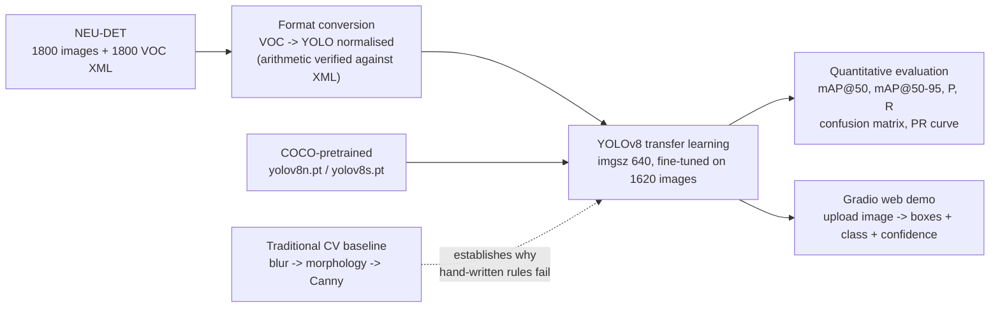
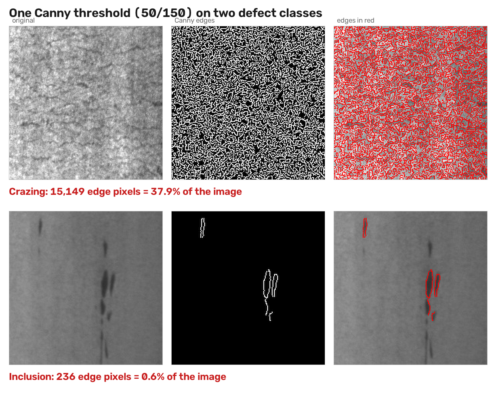
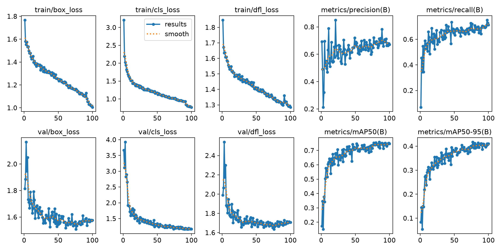
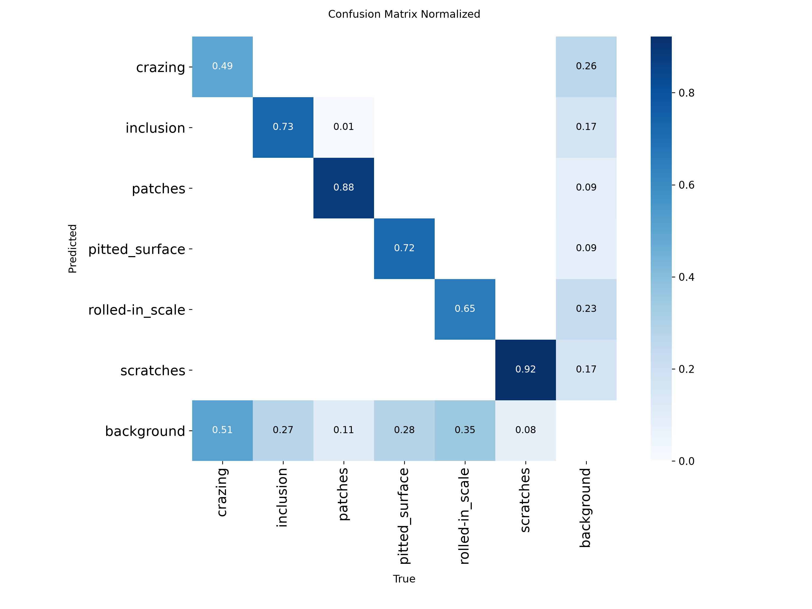
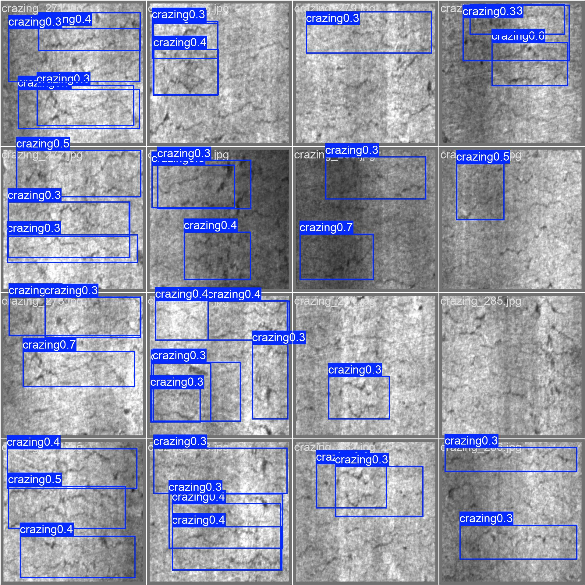
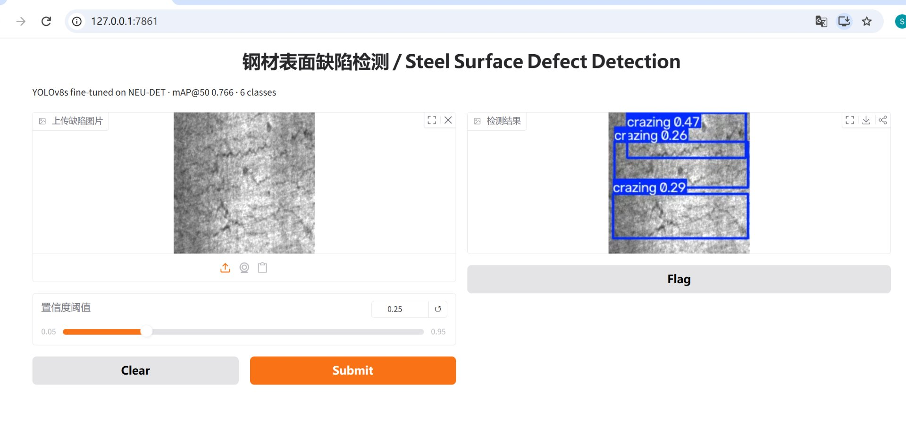

# Steel Surface Defect Detection with YOLOv8

An end-to-end computer-vision pipeline that **locates and classifies surface defects on hot-rolled steel strip** — from raw annotated data, through a hand-built traditional-CV baseline, to YOLOv8 transfer learning, quantitative evaluation and an interactive web demo.

`Python 3.13` · `PyTorch` · `YOLOv8 (Ultralytics)` · `OpenCV` · `Gradio` · `NEU-DET`

> **Status:** training stage. The pipeline itself is complete and verified end-to-end (data format → inference → visualisation). The quantitative results table is intentionally left blank until the fine-tuning runs finish — **no number in this README is estimated or pre-filled**; every value will be copied from `runs/detect/*/results.csv` and `model.val()`.

---

## 1. Problem

Hot-rolled steel strip is inspected visually on the production line. Manual inspection is

- **slow** — the strip moves faster than a human can reliably look at it,
- **subjective** — two inspectors can disagree on whether a patch is a defect or rolled-in scale,
- **unstable** — attention drops after hours of work, and the defects that matter most (crazing, micro-cracks) are exactly the ones that are hardest to see.

Automated Optical Inspection (AOI) has to answer two questions at once: **where** is the defect, and **which of the six defect types** is it? That makes this a *detection* problem, not a classification problem — the location carries as much information as the label, and it is what a downstream sorting/pick-and-place station would actually consume.

**Objective:** build and validate a complete detection pipeline for the six NEU-DET defect classes, and be honest about where it holds up and where it does not.

---

## 2. Method




### 2.1 Traditional CV baseline (built first, deliberately)

Before touching deep learning I implemented the classical pipeline by hand — greyscale conversion, mean/Gaussian/median blur, the four morphological operations (erode, dilate, open, close) and Canny edge detection — and measured it on real defect images. The point was to *quantify* why the classical approach is not enough here, instead of assuming it.

Measured with `cv2.Canny(img, 50, 150)` on 200×200 images (40,000 pixels):

| Image             | Class     | Edge pixels | Share of image |
| ----------------- | --------- | ----------- | -------------- |
| `crazing_1.jpg`   | crazing   | **15,149**  | **38 %**       |
| `inclusion_1.jpg` | inclusion | **236**     | 0.6 %          |

A distributed, texture-like defect (crazing) turns a third of the image into "edges", while a localised defect (inclusion) produces almost none. Raising the thresholds to `(100, 200)` removes only 19 % of crazing's edge pixels (15,149 → 12,230) but 92 % of inclusion's (236 → 20) — so **a single fixed threshold cannot serve both classes**. That asymmetry is the concrete argument for a learned detector.



*The same `cv2.Canny(img, 50, 150)` call on two NEU-DET images. Left: original. Middle: edges. Right: edges in red over the original. On crazing the edges form an undifferentiated field — nothing marks "defect" apart from "texture"; on inclusion they trace the defect but a threshold tuned down to catch more of them would flood every other class. Generated by `tools/make_canny_figure.py`.*

### 2.2 Detection model

YOLOv8 (Ultralytics) is used as a single-stage detector, fine-tuned on NEU-DET by transfer learning from the official COCO-pretrained weights. Rationale: one forward pass gives boxes, classes and confidences; the architecture family scales from `n` to `x` with the same code, which makes a controlled *model-size* comparison possible within the project's budget; and `model.val()` / `model.train()` produce the standard COCO-style metrics and plots directly, so the evaluation is reproducible rather than hand-rolled.

Three runs were executed, one variable at a time: `yolov8n` @640 as the baseline, `yolov8s` @640 as the larger backbone (the tuned configuration, mAP@50 0.766), and `yolov8n` @960 to test whether higher input resolution helps (it did not, §4.2) — so the final report contains a **three-run before/after comparison** rather than a single number.

### 2.3 Label-format verification

The detector consumes normalised YOLO labels, so the conversion was verified against the original VOC annotation rather than trusted. For `crazing_1` (200×200 px):

```
label file      :  0  0.4875  0.49  0.955  0.96        # cls  cx    cy    w     h   (normalised)
x 200 px        :  cx=97.5  cy=98.0  w=191.0  h=192.0
centre + size   ->  xmin=97.5-191/2=2.0   ymin=98.0-192/2=2.0
                    xmax=97.5+191/2=193.0 ymax=98.0+192/2=194.0
VOC XML         :  <xmin>2</xmin> <ymin>2</ymin> <xmax>193</xmax> <ymax>194</ymax>   ->  exact match
```

The box was then drawn back onto the image and visually confirmed to enclose the crazing region (`practice/day010 yolo1.py` writes this figure into `practice/out/`, which is git-ignored as a generated artefact). This rules out silent label corruption before any GPU time is spent.

The single-file check was then extended to the **whole dataset**: for all 1800 images the per-image box count is identical between the VOC release and the converted YOLO copy (distribution 1 box: 483 images, 2: 673, 3: 390, 4: 154, 5: 59, 6: 22, 7: 9, 8: 6, 9: 4 — **4,189 boxes on both sides, zero mismatches**). This cross-check is what allows the two annotation conventions to be treated as interchangeable.

### 2.4 Why normalised coordinates

Normalised coordinates are scale-invariant: training resizes 200×200 inputs to 640×640, and a proportional box stays correct under that transform, whereas pixel coordinates would have to be recomputed. This is also why the same label file works for any `imgsz`.

---

## 3. Dataset

**NEU-DET** — *Northeastern University Surface Defect Database*, a public benchmark of hot-rolled steel strip surface defects.

| Property          | Value                                                                                       |
| ----------------- | ------------------------------------------------------------------------------------------- |
| Classes           | **6** — `crazing`, `inclusion`, `patches`, `pitted_surface`, `rolled-in_scale`, `scratches` |
| Images            | **1800** (300 per class)                                                                    |
| Image size / type | 200 × 200 px, greyscale                                                                     |
| Annotations       | 1800 VOC XML files → converted to YOLO `.txt`; **4,189 boxes** in total (2.33 per image, 1–9) |
| Split used        | **1620 train / 180 val** (3,743 / 446 boxes)                                                |

Acquisition, provenance and re-download instructions are documented in [`tools/NEU-DET_下载说明.md`](tools/NEU-DET_下载说明.md); a one-page visual reference of the six classes is generated by `tools/make_sample_sheet.py` → [`tools/neu_det_samples.png`](tools/neu_det_samples.png); the dataset is audited before training by [`tools/audit_dataset.py`](tools/audit_dataset.py).

**Dataset characteristics that matter downstream**

- At **image** level the six classes are perfectly balanced (300 each). At **box** level they are not — `inclusion` carries 922 boxes (24.6 %) against `pitted_surface`'s 386 (10.3 %), a 2.4× spread produced purely by how many defect spots each image happens to contain. Real production data is far more skewed than either — see §5.
- **Most images contain several defects.** Only 483 of 1800 images (27 %) have a single box; 673 have two, and the maximum is 9. The task is therefore genuine multi-instance detection, not localisation of one region per image.
- Defect **scale varies enormously** between classes: a `crazing` box can cover ~95 % of the frame while an `inclusion` occupies a small local spot. (See §2.3.)

The dataset itself is **not committed** to this repository (`.gitignore`); only the loading, conversion and verification code is.

---

## 4. Results

### 4.1 Verified results available now

| # | Finding                                                                             | Evidence                                                                                                                                                                          |
| - | ----------------------------------------------------------------------------------- | --------------------------------------------------------------------------------------------------------------------------------------------------------------------------------- |
| 1 | **A COCO-pretrained detector cannot be used out of the box for steel defects.**      | `yolov8n.pt` on `scratches_1.jpg`: **0 boxes** at `conf≥0.25`; **2 boxes** at `conf≥0.05`; **4 boxes** at `conf≥0.01` — all labelled **`toothbrush`**, confidence 0.017–0.109     |
| 2 | **The model is not broken; the label space is wrong.**                               | Confidences of 1–10 % show the network is reporting its own uncertainty — none of COCO's 80 classes describes a steel defect, so it falls back on the closest daily-object match   |
| 3 | **The traditional baseline is class-dependent, not simply "weak".**                  | Canny at a single threshold either floods the image (crazing, 38 % of pixels) or misses the defect entirely (inclusion, 0.6 %) — §2.1                                              |
| 4 | **Labels are consistent across both annotation conventions, dataset-wide.**          | 1800/1800 images with identical box counts (4,189 boxes, 0 mismatches) plus an exact coordinate match on a sampled image — §2.3                                                    |
| 5 | **The dataset passes a full pre-flight audit: it is trainable as-is.**               | `tools/audit_dataset.py`: 1620/180 images each paired 1:1 with a label file, every row has exactly 5 fields, all class ids in 0–5, all coordinates within 0–1, all images 200×200  |

Findings 1–2 are the direct motivation for the fine-tuning runs; the inference was repeated at three confidence thresholds so that "nothing is detected" could be distinguished from "something is detected very weakly". Finding 5 is the gate that was passed *before* spending any GPU time.

### 4.2 Quantitative metrics (measured)

Filled in from actual training runs. Every number below comes from `runs/detect/*/results.csv`, read at the epoch with the highest mAP@50 by `tools/compare_runs.py`; nothing is estimated.

| Run                        | Model     | imgsz | epochs | mAP@50    | mAP@50-95 | Precision | Recall | Train time | Params |
| -------------------------- | --------- | ----- | ------ | --------- | --------- | --------- | ------ | ---------- | ------ |
| **A — baseline**           | `yolov8n` | 640   | 100    | 0.758     | 0.414     | 0.714     | 0.699  | 26.3 min   | 3.01 M |
| **B — larger backbone**    | `yolov8s` | 640   | 100    | **0.766** | 0.407     | 0.719     | **0.726** | 52.4 min | 11.1 M |
| **C — higher resolution**  | `yolov8n` | 960   | 100    | 0.730     | 0.376     | 0.649     | 0.722  | 92.1 min   | 3.01 M |

Run A notes:

- Best checkpoint is epoch **85** (mAP@50 = 0.7584); the final epoch is 0.7468. `best.pt` is used for all inference.
- Training time 1575 s on an RTX 4060 Laptop (8 GB) — **15.8 s/epoch** in steady state. Epoch 1 takes 117 s because it includes dataset caching and warm-up.
- Converged early: mAP@50 reaches 0.70 by epoch 40 and then oscillates within 0.70–0.76 for the remaining 60 epochs, while the training losses keep falling slowly. This gap between falling train loss and flat validation score is the over-fitting signature, and it is exactly why the best checkpoint (epoch 85), not the last one, is used.

Source of truth: `runs/detect/yolov8n_baseline/results.csv`.

Run B and C notes — **one hypothesis confirmed, one refuted.** §4.3 localised all the error in `crazing` misses, and suggested two ways to attack it: a larger backbone, and a higher input resolution. Both were run as separate controlled experiments.

- **B — larger backbone (`yolov8s`, same 640 input): confirmed.** `crazing` AP rose **0.464 → 0.548** and its recall **0.367 → 0.494**; overall mAP@50 rose 0.758 → 0.766 and recall 0.699 → 0.726. Cost: 2× training time (31.4 s/epoch vs 15.8) and 3.7× parameters.
- **C — higher resolution (`yolov8n`, 960 input): refuted.** `crazing` AP stayed at **0.464** — the same value to three decimals — while `crazing` recall *fell* to 0.247 and the model got slower (55.3 s/epoch) and less precise overall (mAP@50 0.730, precision 0.649). The source images are **200×200**; upsampling them to 960 adds interpolated pixels, not information. There is nothing to resolve, so the "small-object" diagnosis, while correct about *where* the error is, does not imply that resolution is the fix.
- **Side effect worth recording:** in run B the classes that gained were the weak ones (`crazing` +0.084, `inclusion` +0.070, `pitted_surface` +0.025) and the ones that lost were the strongest (`scratches` −0.057, `patches` −0.027, `rolled-in_scale` −0.050). The larger model does not dominate uniformly; it trades a little accuracy on the easy classes for a lot on the hard one, which is the trade the diagnosis asked for.
- `yolov8s` is the checkpoint used from §4.4 onwards.

Source of truth: `runs/detect/compare_report.md` (generated by `tools/compare_runs.py`).

### 4.3 Training curves, confusion matrix & PR curve (measured)

| Figure                                  | Path                                                       |
| --------------------------------------- | ---------------------------------------------------------- |
| Training / validation loss & mAP curves | `docs/figures/baseline_results.png`                        |
| Normalised confusion matrix             | `docs/figures/baseline_confusion_matrix.png`               |
| Precision–Recall curve                  | `docs/figures/baseline_PR_curve.png`                       |
| F1 vs confidence                        | `docs/figures/baseline_F1_curve.png`                       |



*Run A (`yolov8n` @640). Box losses keep falling after epoch 40 while the validation mAP oscillates between 0.70 and 0.76 — the over-fitting signature that justifies using the best checkpoint rather than the last one.*



*Read with X = True, Y = Predicted (see the reading note below). The bottom row is the miss rate; the diagonal is the recall. Every off-diagonal class cell is ≤ 0.01 — the model never confuses two defect types.*

**Per-class AP@50 across the three runs** (from each run's own `best.pt`, re-validated with `tools/compare_runs.py`)

| Class             | A — `yolov8n` 640 | B — `yolov8s` 640 | C — `yolov8n` 960 | Boxes in val |
| ----------------- | ----------------- | ----------------- | ----------------- | ------------ |
| patches           | **0.945**         | 0.918             | 0.927             | 99           |
| scratches         | **0.895**         | 0.838             | 0.739             | 64           |
| pitted_surface    | 0.788             | **0.813**         | 0.793             | 46           |
| inclusion         | 0.766             | **0.836**         | 0.835             | 89           |
| rolled-in_scale   | **0.657**         | 0.607             | 0.608             | 69           |
| **crazing**       | 0.464             | **0.548**         | 0.464             | 79           |
| **all classes**   | 0.754             | **0.767**         | 0.729             | 446          |

**Failure-mode diagnosis (read off the normalised confusion matrix)**

Reading note: in this version of Ultralytics the matrix is plotted with **X = True, Y = Predicted** — the transpose of the usual textbook convention — and normalised column-wise. The **bottom row** (`Predicted = background`) therefore holds the per-class **miss rate**, and the diagonal holds the recall. The two are complementary (0.49 = 1 − 0.51, 0.73 = 1 − 0.27, 0.92 = 1 − 0.08).

1. **Between-class confusion is essentially zero** — every off-diagonal class cell is ≤ 0.01. The model does not mistake one defect type for another.
2. **All of the error is in misses, not misclassification.** Miss rates: `crazing` **51 %**, `rolled-in_scale` 35 %, `pitted_surface` 28 %, `inclusion` 27 %, `patches` 11 %, `scratches` 8 %.
3. **The worst class is also the smallest and faintest.** `crazing` is a fine, low-contrast crack texture with small boxes, and it is the second most common class by box count (610) — small, dense and faint targets.
4. **Two independent measurements agree.** The per-class AP ranking on the PR curve (patches 0.945 best → crazing 0.465 worst) matches the recall ranking on the confusion matrix exactly. A single-image check agrees too: `crazing_1.jpg` yields **0 boxes** at `conf≥0.25`, consistent with a 0.49 recall. (That image sits in the training split, so it is a sanity check, not evidence of generalisation; the held-out number is the 0.494 recall above.)

The diagnostic value here is that the failure mode is *localised*: the next iteration should target small-object recall (higher input resolution, a larger backbone, small-object augmentation), not the classification head.

Of those three levers, two were actually tested (§4.2): the **larger backbone worked** (`crazing` 0.464 → 0.548) and **higher input resolution did not** (0.464 → 0.464), because the 200×200 source images contain no detail above 200 px to begin with. The lesson is that a correct diagnosis of *where* the error is does not by itself identify *which* fix will work — that has to be measured. Small-object augmentation is the remaining untested lever.


### 4.4 Prediction visualisations — held-out split



*An 8-image batch from the held-out split, drawn by the model itself at `conf≥0.25`. Most defects are found; the faint ones are the ones that go missing — consistent with the per-class miss rates in §4.3.*

Fine-tuning vs. no fine-tuning, same image, same threshold (`conf≥0.25`):

| Image            | COCO-pretrained `yolov8n` (before)                                  | Fine-tuned `best.pt` (after)                          |
| ---------------- | -------------------------------------------------------------------- | ----------------------------------------------------- |
| `scratches_1.jpg`| **0 boxes** (4 `toothbrush` boxes only at `conf≥0.01`, ≤ 0.11 conf)   | **2 × `scratches`**, confidence 0.63 / 0.55           |
| `inclusion_1.jpg`| daily-object labels only                                             | **4 × `inclusion`**, confidence 0.90 / 0.69 / 0.63 / 0.42 |
| `crazing_1.jpg`  | —                                                                    | 0 boxes (hardest class — see §4.3)                    |

The network architecture is identical in both columns; the only difference is 26 minutes of training on 1620 steel-defect images. Annotated output images are written by `practice/day012 practice.py` into `practice/out/`.

### 4.5 Gradio demo

`app.py` is the runnable demo: upload an image (or click one of the three bundled samples in `docs/samples/`), get the annotated image back plus a one-line count per class, with a confidence slider.

```bash
python app.py     # -> http://127.0.0.1:7860
```

Three implementation details worth naming, because each of them is a silent failure mode:

1. **Channel order.** Gradio hands over RGB; OpenCV/Ultralytics expect BGR. Converting on the way in and back on the way out is mandatory — skipping it raises no error, it just swaps red and blue and the detection quality quietly degrades.
2. **The model is loaded once at import**, not inside the callback. Loading inside would re-read the 22 MB checkpoint on every click (~2–3 s) — the page still "works", it just feels broken.
3. **The weight path is resolved from `Path(__file__).parent`**, not from the current working directory, so the demo runs from any directory. (Relative paths resolve against the cwd, not the script location — that exact difference cost an hour earlier in the project.)

A confidence sweep on `scratches_271.jpg` shows the threshold trade-off directly: **9 boxes at conf 0.15 → 7 at 0.25 → 4 at 0.50**, and the ground truth for that image is **4**. At the default 0.25 the model over-produces boxes on its *best* class (AP 0.838) — high AP does not mean every box is right.



*Upload panel (left), confidence slider, and the annotated result (right): `crazing_271.jpg` from the held-out split, 3 boxes at 0.47 / 0.29 / 0.26 — the same numbers the CLI inference prints, confirming the web layer adds no behaviour of its own.*

**Video walkthrough (4 min):** [Steel Surface Defect Detection with YOLOv8 — Project Walkthrough](https://youtu.be/gTecYubChCE) — recorded walkthrough of the dataset audit, the three training runs, the failure-mode diagnosis and the live Gradio demo.

### 4.6 Deployment characteristics (measured)

`tools/bench_latency.py` answers the question a reviewer asks after seeing mAP: *what does it cost to run?* Single-image latency is what the Gradio demo experiences; batch throughput is what a line-scan system would care about.

| Run | Model | imgsz | Params | Weight file | Latency, GPU (batch 1) | Latency, CPU (batch 1) | Throughput, GPU (batch 8) |
| --- | ----- | ----- | ------ | ----------- | ---------------------- | ---------------------- | ------------------------- |
| A | `yolov8n` | 640 | 3.01 M | 6.0 MB | 30.6 ms | 122.9 ms | 105 img/s |
| B | `yolov8s` | 640 | 11.14 M | 21.5 MB | 28.9 ms | 308.3 ms | 81 img/s |
| C | `yolov8n` | 960 | 3.01 M | 6.0 MB | 33.2 ms | 252.2 ms | 61 img/s |

Measured on the machine that trained the models: **RTX 4060 Laptop (8 GB)** + **Intel i7-13620H (10 threads)**, Windows 11, `torch 2.9.1+cu126`. Warm-up passes discarded; median of 30 (GPU latency) / 8 (CPU latency) / 15 (throughput) **round-robin** passes, so thermal drift is shared by all three models instead of concentrated on the last one measured.

Three things this table says:

1. **Batch-1 GPU latency does not rank the models.** 30.6 ms for `yolov8n` against 28.9 ms for `yolov8s` — a 3.7× difference in parameters lands inside run-to-run noise, because roughly 25 ms of every call is fixed Python, letterbox and NMS overhead rather than convolution. Ranking backbones from batch-1 timings alone would be wrong; the compute difference only shows in the throughput column (105 vs 81 img/s). The first version of this script measured one model to completion before starting the next and reported `yolov8n` as *slower* than `yolov8s` by 1.8×, purely because the first checkpoint paid CUDA context creation and cuDNN autotuning.
2. **Resolution is the expensive lever, and here it bought nothing.** `yolov8n` at 960 nearly halves throughput (105 → 61 img/s) and adds 8 % latency, for a *lower* mAP than 640 (0.730 vs 0.758) and an unchanged `crazing` AP (0.464). Consistent with §4.2 — the source images are 200×200, so the extra pixels are interpolation, not information.
3. **CPU inference is not viable at line speed.** 123–308 ms per image is 3–8 images/s, and 200×200 greyscale is the easy case; a full-resolution line-scan frame is far larger. Real deployment needs a GPU, a smaller input, or both.

Honest scope: this is a laptop GPU and a laptop CPU, **not production edge hardware** (Jetson-class, or an industrial smart camera). There is no ONNX or TensorRT export, no measurement inside a real camera pipeline, and no sustained-load thermal test — a 30-second benchmark describes a cold, idle machine.

---

## 5. Limitations

Stated up front rather than discovered by the reviewer:

1. **Small benchmark dataset.** 1800 images at 200×200 greyscale is far below the resolution and volume of a real line-scan camera. Any accuracy figure here is an upper bound for this benchmark, not a production estimate.
2. **Artificial class balance.** Exactly 300 images per class, and even at box level the distribution is only mildly uneven (`inclusion` 922 boxes vs `pitted_surface` 386). Real strip production is far more long-tailed, so per-class performance on genuinely rare classes would very likely degrade. No re-weighting, resampling or augmentation strategy for imbalance has been tested — because this benchmark does not exhibit it.
3. **Benchmark-to-factory domain gap.** NEU-DET images come from one acquisition setup (lighting, magnification, material batch). No cross-factory or cross-camera generalisation test has been run, and none is possible with public data alone.
4. **Uneven annotation granularity between classes.** Boxes are drawn per defect *occurrence*, but the granularity is not consistent across classes: a `crazing` image may carry a single box covering ~95 % of the frame, while other images carry up to 9 small boxes. IoU-based metrics are therefore not directly comparable between classes — a large box is much easier to match than a small one.
5. **No independent test set.** The 180-image validation split ships with the converted dataset (`val: test/images`); there is no separate human-adjudicated test protocol, and the split was neither re-derived nor stratified by me. All reported numbers will therefore describe this one fixed split.
6. **Single-frame only.** No temporal or multi-view consistency; a false positive on one frame is never corrected by neighbouring frames, which a real line-scan system would exploit.
7. **Only six defect types.** Unknown defects are forced into one of six classes with no "unknown / reject" option.
8. **Deployment is characterised on the training machine, not on edge hardware.** §4.6 measures latency and throughput on the laptop GPU and CPU that trained the models — not on Jetson-class or industrial-camera hardware. No ONNX/TensorRT export was benchmarked, and no sustained-load thermal test was run.
9. **The traditional baseline is a comparison, not a competitor.** It was implemented to justify the learned approach on this data; it was not tuned to its own best possible performance.


## 6. Environment & Reproducibility

### 6.1 Reference environment (measured)

| Component                | Version                             |
| ------------------------ | ----------------------------------- |
| OS                       | Windows 11 (x64)                    |
| Python                   | 3.13.15                             |
| PyTorch / torchvision    | 2.9.1+cu126 / 0.24.1+cu126          |
| Ultralytics              | 8.4.163                             |
| OpenCV                   | 5.0.0                               |
| NumPy / Matplotlib       | 2.5.3 / 3.11.2                      |
| Gradio                   | 6.28.0                              |
| GPU                      | NVIDIA RTX 4060 Laptop, 8 GB, CUDA 12.7 driver |
| CPU                      | Intel Core i7-13620H, 10 threads     |

> Installation note: on Windows, the default PyPI wheel of PyTorch is **CPU-only**. The CUDA build has to be taken from the PyTorch wheel index for the matching CUDA version, otherwise `torch.cuda.is_available()` returns `False`. In this project the install had to be done manually (the network here could not reach the default wheel hosts) — worth budgeting time for.

### 6.2 Setup

```bash
git clone git@github.com:ASylviaofmine/defect-detection.git
cd defect-detection

python -m venv .venv && .venv\Scripts\activate
pip install -r requirements.txt          # see the CUDA note above for torch/torchvision
```

### 6.3 Data

`data/` is git-ignored. Re-create it with the instructions in [`tools/NEU-DET_下载说明.md`](tools/NEU-DET_下载说明.md). After that the layout must be:

```
data/
├── NEU-DET/               # original VOC release: IMAGES/ (1800 jpg) + ANNOTATIONS/ (1800 xml)
└── NEU-DET-yolo/          # YOLO-format copy
    ├── data.yaml          # nc: 6 + names
    ├── train/images  train/labels   (1620 images, 3743 boxes)
    └── test/images   test/labels    (180 images,  446 boxes)
```

### 6.4 Pre-flight checks

Run both before spending any GPU time. The audit is the gate: it fails loudly on missing labels, malformed rows, out-of-range class ids or coordinates, and zero-area boxes.

```bash
python tools/audit_dataset.py         # dataset audit -> expect "体检通过"
python tools/make_sample_sheet.py     # -> tools/neu_det_samples.png (six-class visual reference)
```

### 6.5 Training

```bash
yolo detect train data=data/NEU-DET-yolo/data.yaml model=yolov8n.pt \
    epochs=100 imgsz=640 batch=32 cache=True workers=4 device=0 name=yolov8n_baseline
```

The equivalent in Python, which is what the training script uses:

```python
from ultralytics import YOLO

if __name__ == "__main__":          # required on Windows when workers > 0
    model = YOLO("yolov8n.pt")
    model.train(data="data/NEU-DET-yolo/data.yaml", epochs=100, imgsz=640,
                batch=32, cache=True, workers=4, device=0, name="yolov8n_baseline")
```

Two of those arguments are not cosmetic — they are the reason run A takes 15.8 s/epoch instead of ~89 s:

- **`cache=True`** keeps the decoded 1620 images in RAM (~0.2 GB). Without it, the validation pass re-reads 180 files from disk every epoch and costs **93 s/epoch** on its own; with it, ~1 s.
- **`batch=32` + `workers=4`** keep the GPU fed; the defaults (16 / 8) left it idle between batches.

The `if __name__ == "__main__":` guard is mandatory on Windows: with `workers > 0` the spawn start method re-imports the main file, and without the guard `model.train()` re-enters itself (`RuntimeError: An attempt has been made to start a new process before the bootstrapping phase`).

Results land in `runs/detect/<name>/`: `weights/best.pt`, `results.csv` (per-epoch losses and metrics), `confusion_matrix.png`, `PR_curve.png`, `results.png`.

### 6.6 Evaluation & demo

```bash
yolo detect val model=runs/detect/yolov8n_baseline/weights/best.pt data=data/NEU-DET-yolo/data.yaml

python tools/bench_latency.py     # the §4.6 latency / throughput table

python app.py     # Gradio demo -> http://127.0.0.1:7860
```

`app.py` loads `runs/detect/yolov8s_640/weights/best.pt`, so run at least one training run first. The demo is served by the Python process itself — Ctrl+C takes the page down, and it is not a deployment.

### 6.7 Repository layout

```
defect-detection/
├── practice/              # day-by-day learning code, day001 … (see §7)
├── tools/                 # dataset notes, audit + helper scripts
├── notes/                 # Python + OpenCV study notes
├── docs/
│   ├── samples/           # 3 sample images so the demo runs without the full dataset
│   └── figures/           # screenshots and demo-video props used in this README
├── data/                  # dataset — git-ignored
├── runs/                  # training output — git-ignored
├── app.py                 # Gradio web demo
├── LICENSE                # MIT
└── requirements.txt
```

---

## 7. Development Log

This project was built as a **20-day sprint starting from zero Python experience** (I had only used C previously). Every working session was committed the same day, so the commit history is itself the work log:

```bash
git log --date=short --pretty=format:'%ad  %h  %s'
```

| Date          | Stage             | Milestone                                                                                                        |
| ------------- | ----------------- | ---------------------------------------------------------------------------------------------------------------- |
| 09-27         | Python basics 1   | variables, types, operators — multiplication table                                                               |
| 09-30         | Python basics 2   | containers, loops — score stats, FizzBuzz                                                                        |
| 10-04         | Python basics 3–4 | string formatting, `if/elif/else`                                                                                |
| 10-05 → 10-07 | Python basics 5–6 | containers, dict counting; file I/O, exceptions, modules                                                         |
| 10-09 → 10-10 | OpenCV 1          | read/greyscale/blur; NEU-DET dataset acquisition & material                                                      |
| 10-11         | OpenCV 2          | six-class dataset statistics, class-distribution table                                                           |
| 10-12         | Traditional CV    | blur / morphology / Canny on real defects — the "why deep learning" evidence                                     |
| 10-13         | YOLO 1            | COCO model inference, label-format math verified against XML, box drawn back on the image, output-object anatomy; English README skeleton |
| 10-14         | YOLO 2            | full dataset audit (1800 images / 4189 boxes, zero defects), first training run launched — **100 epochs in 26.3 min, mAP@50 0.758** |
| 10-15         | YOLO 3            | results interpretation: PR / F1 curves, per-class AP, **failure-mode diagnosis** (zero class confusion; crazing 51 % missed), fine-tuned inference vs. COCO baseline |
| 10-16         | YOLO 4            | two controlled tuning runs against the recall diagnosis — `yolov8s`@640 (**mAP@50 0.766**, crazing 0.464 → 0.548: hypothesis confirmed) and `yolov8n`@960 (0.730, crazing unchanged at 0.464: hypothesis refuted); three-run comparison tool + per-class AP table |
| 10-17 → 10-18 | Gradio            | web demo + recorded demo video                                                                                   |
| 10-19 → 10-22 | Packaging         | README completion, project summary, English statement-of-purpose material                                        |

---

## 8. What I Implemented vs. AI-Assisted

This project was used as a structured self-teaching programme, so I am explicit about the division of work:

**Implemented by me (the author)**

- All files named `*Practice*` / `*作业练习*` under `practice/` — day001 through day014. I typed, ran and debugged every line of it myself, including the dataset statistics script, the traditional-CV experiment pipeline, the YOLO inference / label-conversion / visualisation code for day 10, the training launch for day 11, the fine-tuned inference plus results interpretation for day 12, and the two tuning runs for day 13.
- All GPU work: model loading, inference at multiple confidence thresholds, the training runs (three of them, run serially because 8 GB of VRAM only fits one), and the resulting observations in §4.1 and §4.2 — run and interpreted by me.
- The design of the tuning experiments in §4.2: writing down the hypothesis, the cost and the metric to watch *before* launching each run, so that a negative result would still be interpretable. Run C was expected to help and did not; that result is reported as-is rather than dropped.
- The per-image prediction-vs-ground-truth counts in §4.5, and the observation that the best-scoring class over-produces boxes — found by counting label rows myself rather than trusting the aggregate mAP.
- The analysis in §2.1, §4.3 and §5 — the edge-pixel measurements, the threshold-sensitivity comparison, the per-class AP reading, the failure-mode diagnosis, the annotation-granularity observation, and the limitations reasoning.
- Running and interpreting the dataset audits in §2.3.
- Noticing that the row/column orientation of the confusion matrix in this Ultralytics version is transposed relative to the usual convention, and re-deriving the miss-rate reading from the source (`metrics.py`) rather than accepting the first interpretation — §4.3.

**AI-assisted**

- The exercise briefs and the clearly marked `参考答案` (reference-answer) blocks inside the same `practice/` files, which were prepared as a teaching scaffold. The workflow rule I followed was to attempt each task first and only then read the reference — the commit history separates "exercises prepared" from "practice done" for exactly this reason.
- `tools/NEU-DET_下载说明.md`, `tools/make_sample_sheet.py`, `tools/make_demo_images.py`, `tools/audit_dataset.py`, `tools/compare_runs.py`, and the first draft of this README.
- `app.py` — the Gradio demo is the reference answer to my day-14 exercise; it was provided as code rather than typed by me from scratch. I ran it, tested it on the sample images and produced the screenshots. The three implementation details in §4.5 are the parts I had to understand to debug it.
- Explanations of unfamiliar concepts (e.g. what mAP is, why normalised coordinates are used) on request, in a beginner-oriented form.
- The initial interpretation of the confusion-matrix orientation in the day-12 exercise brief, which I then verified against the library source and corrected (§4.3). The corrected reading — and the fact that it needed correcting — is the version above.

Reference solutions and helper scripts are **not** claimed as my own work; they are marked in-file where they appear.

---

## 9. Roadmap

- [x] Traditional-CV baseline with measurements
- [x] Full dataset audit — 1800 images / 4189 boxes, 1:1 image–label pairing, every row valid (`tools/audit_dataset.py`)
- [x] Label conversion cross-checked against the VOC release across all 1800 images
- [x] Pretrained-model behaviour characterised (three confidence thresholds)
- [x] **Training run A** — `yolov8n`, 100 epochs, imgsz 640 (26.3 min, best checkpoint = epoch 85)
- [x] **Metrics** — mAP@50 0.758, mAP@50-95 0.414, precision 0.714, recall 0.699 (§4.2)
- [x] **Figures** — training curves, confusion matrix, PR curve, F1 curve (§4.3)
- [x] **Failure-mode diagnosis** — zero between-class confusion; all error is small-object misses, worst class `crazing` (51 % missed) (§4.3)
- [x] **Before/after fine-tuning comparison** — same image, same threshold, `conf≥0.25`: 0 boxes → 2 correct boxes (§4.4)
- [x] **Tuning run B** — `yolov8s` @640: mAP@50 **0.766**, `crazing` AP 0.464 → **0.548** (§4.2)
- [x] **Tuning run C** — `yolov8n` @960: mAP@50 0.730, `crazing` AP unchanged at 0.464 — resolution is the wrong lever for 200×200 sources (§4.2)
- [x] **Prediction visualisations** on the held-out split (§4.4)
- [x] **Gradio demo** — `app.py`, upload → annotated image, per-class count, confidence slider (§4.5)
- [x] **Demo screenshot** (§4.5)
- [x] **Screen recording** of the demo, ~4 min with chapters (§4.5)
- [x] Latency / model-size / accuracy trade-off table (§4.6)
- [ ] Optional: `onnx` export and a CPU inference benchmark
