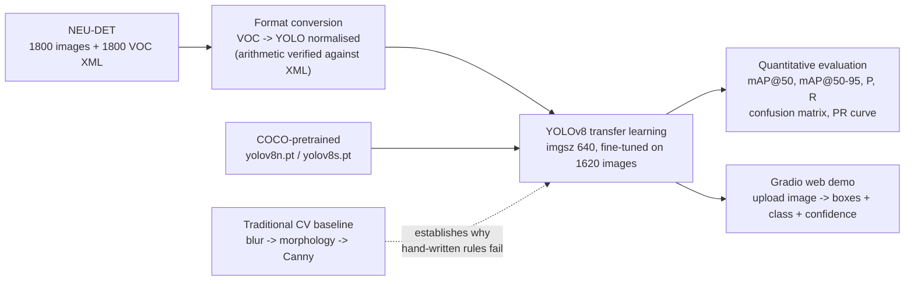

# Steel Surface Defect Detection with YOLOv8

An end-to-end computer-vision pipeline that **locates and classifies surface defects on hot-rolled steel strip** — from raw annotated data, through a hand-built traditional-CV baseline, to YOLOv8 transfer learning, quantitative evaluation and an interactive web demo.

`Python 3.13` · `PyTorch` · `YOLOv8 (Ultralytics)` · `OpenCV` · `Gradio` · `NEU-DET`

> **Status:** training stage. The pipeline itself is complete and verified end-to-end (data format → inference → visualisation). The quantitative results table is intentionally left blank until the fine-tuning runs finish — **no number in this README is estimated or pre-filled**; every value will be copied from `runs/detect/*/results.csv` and `model.val()`.

---

## 1. Problem

Hot-rolled steel strip is inspected visually on the production line. Manual inspection is

- **slow** — the strip moves faster than a human can reliably look at it,
- **subjective** — two inspectors can disagree on whether a patch is a defect or rolled-in scale,
- **unstable** — attention drops after hours of work, and the defects that matter most (crazing, micro-cracks) are exactly the ones that are hardest to see.

Automated Optical Inspection (AOI) has to answer two questions at once: **where** is the defect, and **which of the six defect types** is it? That makes this a *detection* problem, not a classification problem — the location carries as much information as the label, and it is what a downstream sorting/pick-and-place station would actually consume.

**Objective:** build and validate a complete detection pipeline for the six NEU-DET defect classes, and be honest about where it holds up and where it does not.

---

## 2. Method




### 2.1 Traditional CV baseline (built first, deliberately)

Before touching deep learning I implemented the classical pipeline by hand — greyscale conversion, mean/Gaussian/median blur, the four morphological operations (erode, dilate, open, close) and Canny edge detection — and measured it on real defect images. The point was to *quantify* why the classical approach is not enough here, instead of assuming it.

Measured with `cv2.Canny(img, 50, 150)` on 200×200 images (40,000 pixels):

| Image | Class | Edge pixels | Share of image |
|---|---|---|---|
| `crazing_1.jpg` | crazing | **15,149** | **38 %** |
| `inclusion_1.jpg` | inclusion | **236** | 0.6 % |

A distributed, texture-like defect (crazing) turns a third of the image into "edges", while a localised defect (inclusion) produces almost none. Raising the thresholds to `(100, 200)` removes only 19 % of crazing's edge pixels (15,149 → 12,230) but 92 % of inclusion's (236 → 20) — so **a single fixed threshold cannot serve both classes**. That asymmetry is the concrete argument for a learned detector.

### 2.2 Detection model

YOLOv8 (Ultralytics) is used as a single-stage detector, fine-tuned on NEU-DET by transfer learning from the official COCO-pretrained weights. Rationale: one forward pass gives boxes, classes and confidences; the architecture family scales from `n` to `x` with the same code, which makes a controlled *model-size* comparison possible within the project's budget; and `model.val()` / `model.train()` produce the standard COCO-style metrics and plots directly, so the evaluation is reproducible rather than hand-rolled.

Two runs are planned: `yolov8n` as the baseline, then `yolov8s` as the tuned configuration, so that the final report contains a **before/after comparison** rather than a single number.

### 2.3 Label-format verification

The detector consumes normalised YOLO labels, so the conversion was verified against the original VOC annotation rather than trusted. For `crazing_1` (200×200 px):

```
label file      :  0  0.4875  0.49  0.955  0.96        # cls  cx    cy    w     h   (normalised)
x 200 px        :  cx=97.5  cy=98.0  w=191.0  h=192.0
centre + size   ->  xmin=97.5-191/2=2.0   ymin=98.0-192/2=2.0
                    xmax=97.5+191/2=193.0 ymax=98.0+192/2=194.0
VOC XML         :  <xmin>2</xmin> <ymin>2</ymin> <xmax>193</xmax> <ymax>194</ymax>   ->  exact match
```

The box was then drawn back onto the image (`practice/out/label_vis_crazing1.png`) and visually confirmed to enclose the crazing region. This rules out silent label corruption before any GPU time is spent.

### 2.4 Why normalised coordinates

Normalised coordinates are scale-invariant: training resizes 200×200 inputs to 640×640, and a proportional box stays correct under that transform, whereas pixel coordinates would have to be recomputed. This is also why the same label file works for any `imgsz`.

---

## 3. Dataset

**NEU-DET** — *Northeastern University Surface Defect Database*, a public benchmark of hot-rolled steel strip surface defects.

| Property | Value |
|---|---|
| Classes | **6** — `crazing`, `inclusion`, `patches`, `pitted_surface`, `rolled-in_scale`, `scratches` |
| Images | **1800** (300 per class) |
| Image size / type | 200 × 200 px, greyscale |
| Annotations | 1800 VOC XML files → converted to YOLO `.txt` (one box per image) |
| Split used | **1620 train / 180 val** |

Acquisition, provenance and re-download instructions are documented in [`tools/NEU-DET_下载说明.md`](tools/NEU-DET_下载说明.md); a one-page visual reference of the six classes is generated by `tools/make_sample_sheet.py` → [`tools/neu_det_samples.png`](tools/neu_det_samples.png).

**Dataset characteristics that matter downstream**

- The classes are **perfectly balanced** (300 each). Real production data is not — see §5.
- Defect **scale varies enormously** between classes: a crazing box covers ~95 % of the frame, while an inclusion occupies a small local spot. (See §2.3.)
- Annotations are **region-level**: one bounding box per image marking where the defect pattern lies, not one box per individual crack.

The dataset itself is **not committed** to this repository (`.gitignore`); only the loading, conversion and verification code is.

---

## 4. Results

### 4.1 Verified results available now

| # | Finding | Evidence |
|---|---|---|
| 1 | **A COCO-pretrained detector cannot be used out of the box for steel defects.** | `yolov8n.pt` on `scratches_1.jpg`: **0 boxes** at `conf≥0.25`; **2 boxes** at `conf≥0.05`; **4 boxes** at `conf≥0.01` — all labelled **`toothbrush`**, confidence 0.017–0.109 |
| 2 | **The model is not broken; the label space is wrong.** | Confidences of 1–10 % show the network is reporting its own uncertainty — none of COCO's 80 classes describes a steel defect, so it falls back on the closest daily-object match |
| 3 | **The traditional baseline is class-dependent, not simply "weak".** | Canny at a single threshold either floods the image (crazing, 38 % of pixels) or misses the defect entirely (inclusion, 0.6 %) — §2.1 |
| 4 | **Labels are consistent across both annotation conventions.** | Normalised→pixel conversion matches the VOC XML exactly — §2.3 |

Finding 1/2 is the direct motivation for the fine-tuning runs; it was checked at three confidence thresholds so that "nothing is detected" could be distinguished from "something is detected very weakly".

### 4.2 Quantitative metrics — *pending, will be measured*

Filled in from the actual training runs. Empty cells are not estimates.

| Run | Model | imgsz | epochs | mAP@50 | mAP@50-95 | Precision | Recall | Inference (ms/img) | Params |
|---|---|---|---|---|---|---|---|---|---|
| A — baseline | `yolov8n` | 640 | 100 | _pending_ | _pending_ | _pending_ | _pending_ | _pending_ | _pending_ |
| B — tuned | `yolov8s` | 640 | _TBD_ | _pending_ | _pending_ | _pending_ | _pending_ | _pending_ | _pending_ |

Source of truth: `runs/detect/*/results.csv` + `model.val(split="val")`.

### 4.3 Training curves, confusion matrix & PR curve — *pending*

| Figure | Planned path |
|---|---|
| Training / validation loss & mAP curves | `docs/figures/results_curves.png` |
| Normalised confusion matrix (6×6) | `docs/figures/confusion_matrix.png` |
| Precision–Recall curve | `docs/figures/PR_curve.png` |

### 4.4 Prediction visualisations — *pending*

Side-by-side predictions per class on the held-out split → `docs/figures/predictions_test.png`.
Qualitative failure cases will be included, not only the good ones.

### 4.5 Gradio demo — *pending*

Screenshot → `docs/figures/gradio_demo.png`; 1–2 minute screen recording → linked here.

---

## 5. Limitations

Stated up front rather than discovered by the reviewer:

1. **Small benchmark dataset.** 1800 images at 200×200 greyscale is far below the resolution and volume of a real line-scan camera. Any accuracy figure here is an upper bound for this benchmark, not a production estimate.
2. **Artificial class balance.** Exactly 300 images per class. Real strip production has a long-tailed defect distribution, so per-class performance on rare classes would very likely degrade.
3. **Benchmark-to-factory domain gap.** NEU-DET images come from one acquisition setup (lighting, magnification, material batch). No cross-factory or cross-camera generalisation test has been run, and none is possible with public data alone.
4. **Coarse, region-level annotations.** One box per image, often covering most of the frame, so the model is evaluated on "where is the defect region", not on exact defect extent. IoU-based metrics are therefore optimistic for classes with very large boxes.
5. **Single-frame only.** No temporal or multi-view consistency; a false positive on one frame is never corrected by neighbouring frames, which a real line-scan system would exploit.
6. **Only six defect types.** Unknown defects are forced into one of six classes with no "unknown / reject" option.
7. **No deployment characterisation.** Latency is measured on a laptop GPU (RTX 4060 Laptop, 8 GB), not on production edge hardware; model-size vs accuracy vs throughput trade-offs are not yet quantified.
8. **The traditional baseline is a comparison, not a competitor.** It was implemented to justify the learned approach on this data; it was not tuned to its own best possible performance.

---

## 6. Environment & Reproducibility

### 6.1 Reference environment (measured)

| Component | Version |
|---|---|
| OS | Windows 11 (x64) |
| Python | 3.13.15 |
| PyTorch / torchvision | 2.9.1+cu126 / 0.24.1+cu126 |
| Ultralytics | 8.4.163 |
| OpenCV | 5.0.0.93 |
| NumPy / Matplotlib | 2.5.3 / 3.11.2 |
| Gradio | 6.28.0 |
| GPU | NVIDIA RTX 4060 Laptop, 8 GB, CUDA 12.7 driver |

> Installation note: on Windows, the default PyPI wheel of PyTorch is **CPU-only**. The CUDA build has to be taken from the PyTorch wheel index for the matching CUDA version, otherwise `torch.cuda.is_available()` returns `False`. In this project the install had to be done manually (the network here could not reach the default wheel hosts) — worth budgeting time for.

### 6.2 Setup

```bash
git clone git@github.com:ASylviaofmine/defect-detection.git
cd defect-detection

python -m venv .venv && .venv\Scripts\activate
pip install -r requirements.txt          # see the CUDA note above for torch/torchvision
```

### 6.3 Data

`data/` is git-ignored. Re-create it with the instructions in [`tools/NEU-DET_下载说明.md`](tools/NEU-DET_下载说明.md). After that the layout must be:

```
data/
├── NEU-DET/               # original VOC release: IMAGES/ (1800 jpg) + ANNOTATIONS/ (1800 xml)
└── NEU-DET-yolo/          # YOLO-format copy
    ├── data.yaml          # nc: 6 + names
    ├── train/images  train/labels   (1620)
    └── test/images   test/labels    (180)
```

### 6.4 Sanity check

```bash
python tools/make_sample_sheet.py     # -> tools/neu_det_samples.png  (six-class visual reference)
```

### 6.5 Training

```bash
yolo detect train data=data/NEU-DET-yolo/data.yaml model=yolov8n.pt epochs=100 imgsz=640 device=0
```

### 6.6 Evaluation & demo

```bash
yolo detect val model=runs/detect/train/weights/best.pt data=data/NEU-DET-yolo/data.yaml

python app.py     # Gradio demo -> http://127.0.0.1:7860
```

*(`app.py`, the evaluation wrapper and the figure-export script are added during the training/evaluation stage; this section is updated as each one lands.)*

### 6.7 Repository layout

```
defect-detection/
├── practice/      # day-by-day learning code (see §7)
├── tools/         # dataset acquisition notes + helper scripts
├── notes/         # Python + OpenCV knowledge summary (study notes)
├── data/          # dataset — git-ignored
├── app.py         # Gradio web demo                      (planned)
└── requirements.txt
```

---

## 7. Development Log

This project was built as a **20-day sprint starting from zero Python experience** (I had only used C previously). Every working session was committed the same day, so the commit history is itself the work log:

```bash
git log --date=short --pretty=format:'%ad  %h  %s'
```

| Date | Stage | Milestone |
|---|---|---|
| 09-27 | Python basics 1 | variables, types, operators — multiplication table |
| 09-30 | Python basics 2 | containers, loops — score stats, FizzBuzz |
| 10-04 | Python basics 3–4 | string formatting, `if/elif/else` |
| 10-05 → 10-07 | Python basics 5–6 | containers, dict counting; file I/O, exceptions, modules |
| 10-09 → 10-10 | OpenCV 1 | read/greyscale/blur; NEU-DET dataset acquisition & material |
| 10-11 | OpenCV 2 | six-class dataset statistics, class-distribution table |
| 10-12 | Traditional CV | blur / morphology / Canny on real defects — the "why deep learning" evidence |
| 10-13 | YOLO 1 | COCO model inference, label-format math verified against XML, box drawn back on the image, output-object anatomy |
| 10-14 → 10-16 | YOLO 2–4 | conversion audit, training runs, tuning, **quantitative metrics table** |
| 10-17 → 10-18 | Gradio | web demo + recorded demo video |
| 10-19 → 10-22 | Packaging | README completion, project summary, English statement-of-purpose material |

---

## 8. What I Implemented vs. AI-Assisted

This project was used as a structured self-teaching programme, so I am explicit about the division of work:

**Implemented by me (the author)**

- All files named `*Practice*` / `*作业练习*` under `practice/` — day 1 through day 10. I typed, ran and debugged every line of it myself, including the dataset statistics script, the traditional-CV experiment pipeline, and the YOLO inference / label-conversion / visualisation code for day 10.
- All GPU work: model loading, inference at multiple confidence thresholds, and the resulting observations in §4.1 — run and interpreted by me.
- The analysis in §2.1 and §5 — the edge-pixel measurements, the threshold-sensitivity comparison, and the limitations reasoning.
- Verification of the label conversion against the raw VOC XML (§2.3).

**AI-assisted**

- The exercise briefs and the clearly marked `参考答案` (reference-answer) blocks inside the same `practice/` files, which were prepared as a teaching scaffold. The workflow rule I followed was to attempt each task first and only then read the reference — the commit history separates "exercises prepared" from "practice done" for exactly this reason.
- `tools/NEU-DET_下载说明.md`, `tools/make_sample_sheet.py`, `tools/make_demo_images.py` and the first draft of this README.
- Explanations of unfamiliar concepts (e.g. what mAP is, why normalised coordinates are used) on request, in a beginner-oriented form.

Reference solutions and helper scripts are **not** claimed as my own work; they are marked in-file where they appear.

---

## 9. Roadmap

- [x] Traditional-CV baseline with measurements
- [x] Dataset verified, label conversion cross-checked against VOC XML
- [x] Pretrained-model behaviour characterised (three confidence thresholds)
- [ ] **Training run A** — `yolov8n`, 100 epochs, imgsz 640
- [ ] **Metrics** — mAP@50, mAP@50-95, precision, recall (§4.2)
- [ ] **Figures** — training curves, confusion matrix, PR curve (§4.3)
- [ ] **Tuning run B** — `yolov8s` + parameter changes, before/after comparison
- [ ] **Prediction visualisations** on the held-out split, including failure cases (§4.4)
- [ ] **Gradio demo** — screenshot + 1–2 min screen recording (§4.5)
- [ ] Latency / model-size / accuracy trade-off table
- [ ] Optional: `onnx` export and a CPU inference benchmark
